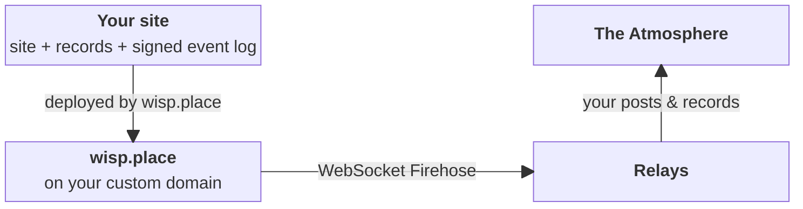

The [at-SDP](https://tangled.org/byjp.me/at-sdp) CLI tool turns a static site into a read-only atproto PDS. Your site's domain becomes a `did:web` account with its records (lexicons, Bluesky profile, anything you want to publish) served as files, which wisp.place hosts like any other site.

For [supporters](/reference/supporters/), and only on custom domains, wisp.place fills the one gap normal static hosters don't: answering the Relays' firehose websocket request. This informs the rest of the Atmosphere what new records you just published.

wisp.place never holds your keys, and so can't modify the content you share.



## Requirements

- your wisp.place account is a [supporter](/reference/supporters/)
- the site is served on a custom domain, which will be your  `did:web`
- your site contains the files [at-SDP](https://tangled.org/byjp.me/at-sdp) provides — particularly the `_redirects` entries

## Setup

[Install at-SDP](https://tangled.org/byjp.me/at-sdp#install), and set up your repo:

```bash
$ at-sdp init --domain example.com
z3YourPrivateKeyHereKeepItSafe
Store the line above as the AT_SDP_PRIVATE_KEY secret in CI. It isn't saved anywhere else.
Wrote at-sdp.json; commit it.
Create this DNS record so your lexicons resolve:
  _lexicon.example.com  TXT  "did=did:web:example.com"
```

(If you lose your private key you can just run this `init` command again, but you make extra work for the atproto network, so it's best to keep it safe!)

Then prepare one or more folders with the JSON atproto records you want to have in your atproto account, and build your repo into your site (assuming your site files are in `./site`):

```bash
$ at-sdp build --out ./site ./lexicons ./path/to/other/records
warning: no live repo at https://example.com (HTTP 404); making a new commit
rev 3mzaaxgfgor22 new
event #identity seq 1793517051818647
event #account seq 1793517051818648
event #commit seq 1793517051818649
```

This will make files inside `site/.well-known/` and `site/xrpc/`. These are your atproto repo, signed so only you can make them. It'll also add some entries to `site/_redirects`, which is what makes the files into a functional read-only PDS.

(You can run this `at-sdp build` step as part of any automation you have for building your site.)

Then you should check the static PDS works (which also waits until the wisp.place deploy is complete), and notify the relays of any changes:

```bash
$ at-sdp check --site site --firehose https://example.com
ok: https://example.com serves did:web:example.com at rev 3mzaaxgfgor22 (2 records, 0 blobs, firehose to seq 1793517051818649)

$ at-sdp notify
ok wss://example.com/xrpc/com.atproto.sync.subscribeRepos
ok https://bsky.network/xrpc/com.atproto.sync.requestCrawl
ok https://atproto.africa/xrpc/com.atproto.sync.requestCrawl
```

Your static PDS is now live! You can browse the records at https://pds.ls/at://example.com and in whatever Atmosphere apps you made records for.
